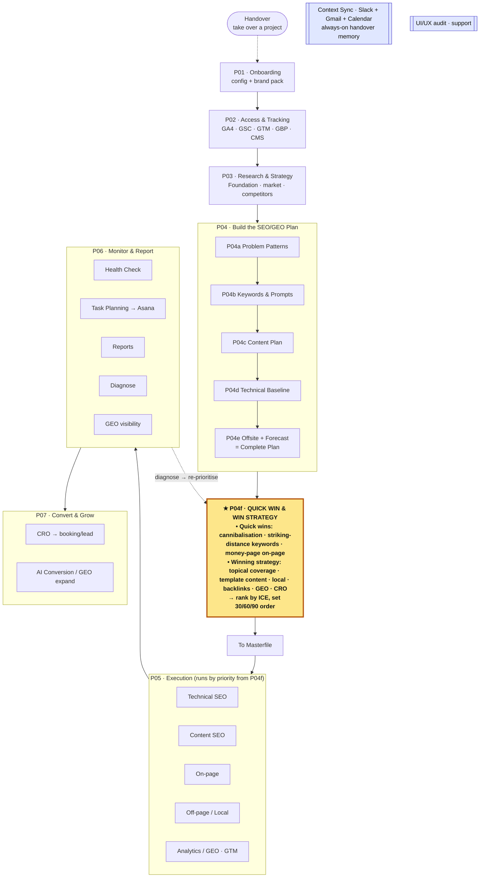

# Pipeline SEO/GEO (P01–P07 + Handover)

Nguồn: sơ đồ "Heads On Pillows SEO/GEO Project Pipeline". Mỗi bước gắn với skill + tab/output + cổng duyệt.
Chi tiết ghi output ở từng skill trong `.claude/skills/`.

## Diagram

Bản chi tiết (card từng stage, gates, lanes, vòng lặp tháng): [`pipeline-board.html`](./pipeline-board.html)
— mở bằng trình duyệt để xem đầy đủ. Sơ đồ Mermaid dưới đây là bản tóm GitHub tự render.

Approval gate on every step: **PIC runs → SEN reviews → AM/PM sends to client.** Claude never sends
to the client. Context Sync and UI/UX are cross-cutting (not a linear step).

> **P04f** là bước mới & bản lề: Plan nói *làm gì*, P04f nói *làm gì trước để ra kết quả ngay* và
> *chiến lược nào để thắng dự án* (đạt KPI, đẩy booking/submit/purchase/revenue). Xem `/quick-win`.

| Bước | Tên | Skill | Người chạy → duyệt | Output chính |
| --- | --- | --- | --- | --- |
| Handover | Nhận bàn giao | `/handover` | PIC mới | Brief rủi ro + câu hỏi cho buổi catch-up |
| Xuyên suốt | Context Sync | `/context-sync` (hằng tuần) | PIC | `project/context.md` từ Slack + Gmail + Calendar |
| P01 | Onboarding | `/new-project`, `/p01-onboarding` | AM/PM + PIC | `config.yaml`, brand pack, danh sách thiếu |
| P02 | Access & Tracking | `/p02-access` | PIC → AM/PM+PIC | Tab SEO Assets (TRUE/FALSE), check GA4/GSC/GTM/CMS/GBP/booking |
| P03 | Research & Strategy | `/p03-foundation`, `/p03-market` | PIC | Tab Foundation + báo cáo thị trường/đối thủ |
| P04a | Problem Patterns | `/p04a-patterns` | PIC | Tab Problem Pattern (theo Category Leader) |
| P04b | Keywords & Prompts | `/p04b-tracking` | PIC | Tab Tracking (keyword 2 ngôn ngữ + prompt) |
| P04c | Content Plan | `/p04c-content-plan` | PIC | Tab Content Plan ≥ 6 tháng |
| P04d | Technical Checklist | `/p04d-tech-baseline` | PIC | Tab Technical Baseline (5 layer) + Sheet Website Audit |
| P04e | Complete Plan | `/p04e-offsite`, `/forecast`, `/p04e-review` | PIC → **SEN** | Tab Offsite + Measurement; Plan hoàn chỉnh |
| **P04f** | **Quick Win & Win Strategy** | `/quick-win` | PIC → **SEN** | Quick Win đã xếp hạng (ICE) + trụ chiến lược + experiments; sắp lại Content Plan + lịch 30/60/90 |
| P04→P05 | To Masterfile | `/p04-to-masterfile` | PIC | Đồng bộ Plan → Masterfile |
| P05 | Technical SEO | `/tech-audit`, `/tech-fix` | PIC → SEN | Website Audit, Fix List, Schema doc, patch/PR |
| P05 | Content SEO | `/content-month`, `/research`, `/outline`, `/write`, `/translate`, `/html` | PIC → SEN → khách | Content Doc theo format |
| P05 | On-page SEO | `/onpage <url>` | PIC | Title/meta/H1/schema/internal link |
| P05 | Off-page / Local | `/offpage-plan`, `/gbp-posts` | PIC | Prospect list, outreach, tab GBP Posts |
| P05 | Analytics / GEO | `/gtm-plan`, `/gtm-build`, `/gtm-verify`, `/llms-txt` | PIC → SEN | Tracking Plan, GTM JSON, llms.txt |
| P06a | Health Check | `/health-check` (scheduled, hằng tuần) | PIC → SEN | Báo cáo tuần + cảnh báo |
| P06a | Task Planning | `/task-plan weekly / monthly` | PIC → SEN | Task tuần/tháng → Asana (section Proposed) |
| P06b/c | Reports | `/report monthly`, `/report executive` | PIC → SEN | Báo cáo tháng / executive |
| P06d | Client Meeting | `/meeting-prep`, `/meeting-notes` | AM/PM + PIC | Agenda, action items |
| P06 | Diagnosis | `/diagnose <url>` | PIC | Theo cây Path 1/2/3 |
| P06e/f | GEO | `/geo-visibility`, `/geo-gap`, `/geo-fix-mentions` | PIC | Gap vs đối thủ, sửa mention sai |
| P07a | CRO | `/cro-audit` | PIC → SEN | Tối ưu booking/lead |
| P07b | AI Conversion | `/geo-expand` | PIC | Mở rộng prompt, tối ưu trang được AI trích |
| UI/UX | Audit | `/uiux-audit` | PIC/Designer | Báo cáo chú thích + Figma |

## Cây chẩn đoán P06 (diagnose)

- **Path 1 — content kém:** chưa index → sửa kỹ thuật. Đã index mà vô giá trị → content research →
  intent khớp? → brief lệch trend? → brand fit + nội dung cảm nhận → vẫn kém → quay lại onboarding.
- **Path 2 — mọi thứ ổn nhưng yếu:** nghi kỹ thuật → full-site technical audit (UX/UI, tốc độ).
- **Path 3 — kỹ thuật cũng ổn:** kiểm interface + CTA → P07a.
- **GEO P06e:** chỉ số kém → tìm GEO gap vs đối thủ (research P03) → bổ sung nội dung site.
- **GEO P06f:** mention sai/tiêu cực → tìm nguồn → sửa thông tin chính thức trên site → P07b.
